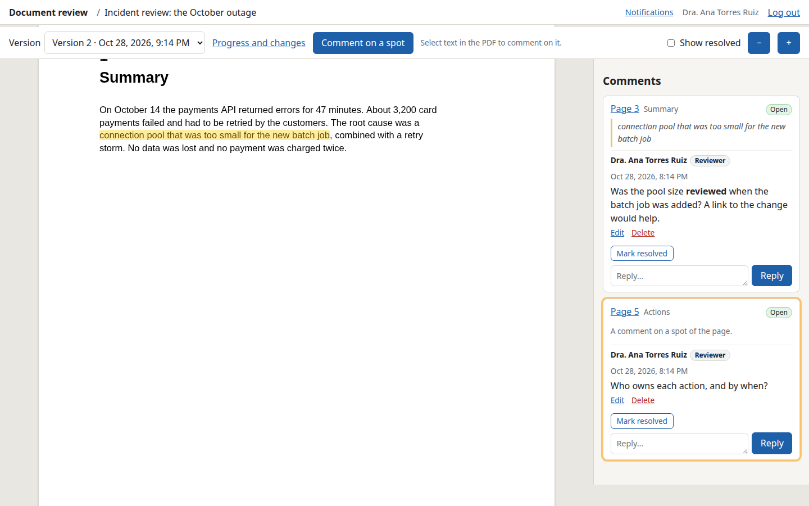

# doc-review

A small self-hosted web app for reviewing documents: you publish PDF versions of
a document, the people you invite comment on them in threads anchored to the
text, and you get the comments on the web, on Telegram, by email and in Emacs,
next to your sources (org, LaTeX or Markdown).

It started as the review site of a thesis and works the same for papers,
reports for clients or any other document you build as a PDF.



## Features

- **Several documents per installation**, each with a short name (`/d/thesis`),
  a title, a language (English or Spanish: its pages, emails and notifications),
  a visibility mode and a default role for new reviewers. Documents can be
  renamed and archived (read-only).
- **Versions**: each published PDF is a new version, with an optional note and
  an optional `progress.json` (words per section, goals, status). The server
  never builds your document. Comments belong to the version they were made on.
- **Reviewers**: a person (name, optional email, notification preferences) can be
  invited to several documents, with a role label in each (Director,
  Co-director, Reviewer, Client, Co-author… free text with suggestions). Each
  invitation has its own **secret link**, revocable and rotatable; opening any of
  a person's links signs them in and shows all their documents. Each person has
  a page to edit their name, email and notifications, see every invitation's
  state, email them a new link, and delete them (if they never commented) or
  archive them.
- **Threads** anchored to selected text or to a spot of a page: replies, resolve
  (the opener or the owner) and reopen (anyone who sees the thread), edits (the
  previous texts are kept) and soft deletes of one's own comments. Per document,
  reviewers see either everyone's comments or only theirs and yours.
- **Progress and changes**: the progress table per section, and what changed
  since the previous version, sentence by sentence and per section, computed on
  the server from the PDF text (the whole document when sections can't be
  located or there is no `progress.json`).
- **Notifications**: to you, by Telegram and/or email (SMTP, e.g. Proton Mail),
  at once or as a daily digest per document, including edits. Reviewers can opt in
  to an email when a version is published and to emails (at once, or a daily
  digest) when someone replies in a thread they take part in.
- **Emacs** (`emacs/doc-review.el`): publish from the project, read the comments
  in an org buffer linked to the matching place in your sources, reply, resolve,
  see open comments as Flymake notes. See [docs/emacs.md](docs/emacs.md).
- **CLI** (`doc-review`) for the same from a shell or a Makefile.
- **English and Spanish** user interface, server messages and emails.

Documentation: [docs/usage.md](docs/usage.md) (owner and reviewer workflows,
notifications setup), [docs/emacs.md](docs/emacs.md),
[docs/deploy.md](docs/deploy.md), [docs/security.md](docs/security.md), and a
short guide for Spanish-speaking reviewers,
[docs/reviewers.es.md](docs/reviewers.es.md).

## Architecture

```
 reviewers' browsers          your browser            Emacs (url.el)   CLI (fetch)
 (pdf.js viewer, ES modules)  (dashboard)                  │ Bearer owner token
        │ session cookie + CSRF token │                     │
        └──────────────┬──────────────┴─────────────────────┘
               node:http server (TypeScript, Node 22)
   router · auth/sessions · CSRF · CSP · rate limits · i18n (en, es)
   routes: auth · documents · versions · threads · reviewers · settings · static
        │                 │                    │                    │
   Postgres (pg)     PDF store           pdf.js (Node)        notifications
   CloudNativePG     PVC dir or S3/R2    worker thread:       Telegram, SMTP
   or PGlite (dev)   (aws4fetch)         validate + text      (nodemailer)
```

| Path | What |
|---|---|
| `src/server/app.ts` | Security headers, authentication, error handling; builds the router |
| `src/server/router.ts`, `context.ts`, `validate.ts` | The router, the request context and guards, input validation |
| `src/server/routes/` | Route modules: `auth`, `documents`, `versions`, `threads`, `reviewers`, `settings`, `static` |
| `src/server/pages/` | Server-rendered HTML; everything escaped |
| `src/i18n/` | Message catalogs (`en.ts`, `es.ts`), plurals, Accept-Language |
| `src/repo.ts` | All SQL |
| `src/db/` | `pg`/PGlite adapter and migrations (`schema_migrations`) |
| `src/pdf/` | PDF validation and text extraction (pdf.js legacy build) in a worker thread |
| `src/diff.ts` | Section location in the PDF, Myers diff over sentences |
| `src/progress.ts` | `progress.json` validation (and the `avance.json` alias); generation from org includes |
| `src/notify/notify.ts` | Telegram, SMTP, digests, reviewer emails |
| `src/storage.ts` | PDF storage: directory or S3 |
| `src/cli.ts`, `src/client.ts`, `src/format.ts` | CLI (server and owner commands) |
| `public/` | Browser code: `viewer.js` (pdf.js, selection, threads), `admin.js`, `common.js`, `i18n-format.js` |
| `emacs/` | Emacs client and its ERT tests |
| `deploy/helm/doc-review` | Helm chart |

### Data model

`documents` (slug, title, language, visibility `all|own`, default role,
archived) · `people` (name, optional email, `notify_versions`, `notify_replies`
`instant|daily|never`) · `invitations` (person × document, role label, hashed
link secret, rotated/revoked dates) · `sessions` (hashed id, kind
owner/reviewer, person, CSRF token, sliding expiry, owner-token fingerprint) ·
`session_invitations` (the links a reviewer session was opened with) ·
`versions` (document, number, note, PDF key + SHA-256, pages, `progress` JSON,
located section pages) · `version_pages` (extracted text) · `version_diffs`
(stored diff against the previous version) · `threads` (document, version, page,
anchor `text|point`, quote, normalized rects, status, who resolved it) ·
`comments` (soft deletes) · `comment_edits` (the last 20 previous texts) ·
`digest_runs` (owner, per document and day) · `reviewer_digest_runs` (per
invitation and day).

Migrations are in `src/db/migrations.ts`. In the cluster the chart runs them in
a Helm hook Job with the CloudNativePG `<app>_admin` role (owner of the tables),
whose DSN only that Job sees; the app runs with `DATABASE_URL` (the `<app>_app`
role) and `MIGRATE_ON_START=false`, and refuses to start if one is pending.
Locally they run at startup (`DATABASE_ADMIN_URL`, default `DATABASE_URL`).
`doc-review migrate` runs them by hand.

### progress.json

```json
{"schema": 1, "title": "…", "generated_at": "2026-10-24T18:00:00Z", "total_words": 2950,
 "sections": [{"id": "01-introduction", "title": "Introduction", "words": 1450,
               "goal": 3000, "status": "review"}]}
```

`status` is `draft`, `review`, `done` or `null`; `goal` is a word goal or
`null`. It is optional. The thesis template's `make avance` writes `avance.json`
(`chapters` instead of `sections`, statuses `borrador`/`revision`/`terminado`):
it is accepted as it is. `doc-review progress root.org` builds one from the
`#+INCLUDE:` files of an org document. Sections are located in the PDF by their
titles (after the table of contents) for the per-section diff.

### Why these choices

- **Postgres** because the cluster already has CloudNativePG with per-app roles,
  WAL archiving and daily backups to R2. PGlite (Postgres compiled to WASM) runs
  the same SQL in-process, so development and tests need no database server and
  no network. `database.type: embedded` in the chart runs PGlite on the PVC.
- **PDFs in R2** (S3) by default in the cluster: off the node's disk and not in
  the database's WAL. A PVC also works.
- **pdf.js** both in the browser (canvas + text layer, so selections map to page
  coordinates) and on the server (upload validation, text for the diff), in a
  worker thread with heap and time limits. The legacy build is served to
  browsers because the modern one needs very recent JavaScript.
- **One link per invitation**, one session per person: see
  [docs/security.md](docs/security.md#links-and-sessions).
- No frontend framework: server-rendered pages plus small ES modules; the
  scripts get their messages from a JSON block in the page.

## Security

The full threat model and the list of measures are in
[docs/security.md](docs/security.md). In short:

- Authentication on every route except the health checks and static files.
  Reviewers sign in with an unguessable per-invitation link (stored hashed,
  revocable, rotatable; the URL is cleaned right away, never logged, and a
  browser with someone else's session asks before switching); the owner with a
  token (bearer for the CLI and Emacs, a session on the web; rotating the token
  ends the web sessions).
- Cookie sessions are `__Host-`, `HttpOnly`, `Secure`, `SameSite=Lax`; every
  cookie-authenticated mutation needs the same origin (with a `Sec-Fetch-Site`
  fallback for `Origin: null`) and the session's CSRF token.
- Strict CSP (no inline scripts or styles), `Referrer-Policy: same-origin`
  (`no-referrer` on link pages), `X-Frame-Options: DENY`, HSTS, `no-store`.
- All output escaped; comments get a tiny markup subset; control and bidi
  characters are stripped from untrusted text on input and again in the CLI,
  Emacs and notifications.
- Access is per document: reviewers get 404 for documents they aren't invited
  to; visibility `own` hides other reviewers' threads, comments, names and
  counts, also in notifications; only the opener or the owner can resolve.
- Uploads: size limits, magic bytes, every page parsed by pdf.js in a worker
  thread (512 MB heap, 90 s). JSON bodies, comments, quotes, rects and integers
  are validated (400, never a database error).
- Rate limits per IP (IPv6 per /64) on links, login and failed tokens; writes
  per person; a daily cap of comments per reviewer.
- The CLI and Emacs only send the token over https (http only to localhost), and
  only to the server it was configured for.
- The container runs as non-root with a read-only root file system and no
  capabilities; an optional NetworkPolicy limits traffic.

## Running locally

Requirements: Node ≥ 22.12, pnpm (corepack). No database server needed.

```sh
pnpm install
pnpm build
node dist/cli.js gen-token            # prints a token and its SHA-256
OWNER_TOKEN_SHA256=<sha256> PUBLIC_URL=http://localhost:8080 node dist/cli.js serve
# data (PGlite + PDFs) goes to ./data
```

To have the `doc-review` command on your PATH: `pnpm link --global` (or call
`node dist/cli.js`). Then put `{"url": "http://localhost:8080", "token":
"<token>"}` in `~/.config/doc-review/config.json` (`chmod 600`) and:

```sh
node test/fixtures/make-pdf.mjs /tmp/v1.pdf          # a sample PDF + progress.json
doc-review documents create thesis "My thesis" --language en
doc-review publish -d thesis /tmp/v1.pdf /tmp/v1.progress.json -m "First version"
doc-review invite -d thesis "Dr. Jane Roe" --email jane@example.org --role Director
doc-review comments -d thesis
```

Open `http://localhost:8080/login` for the owner dashboard, and the printed
`/a/…` link in another browser profile to act as a reviewer.

`scripts/smoke.sh` (or `make smoke`) runs the whole flow end to end against a
throwaway server: two documents, a person invited to both with different roles
and a second reviewer on one, comments, resolve rules, visibility, emails to a
fake SMTP server, the CLI and Emacs (batch) from a `.doc-review.json` project.
With `CHROME=/path/to/chrome` it also drives the UI with playwright-core and
refreshes `docs/images/`.

## Configuration

### Server (environment)

| Variable | Default | |
|---|---|---|
| `PUBLIC_URL` | `http://localhost:8080` | Exact public origin (links, CSRF origin check) |
| `PORT`, `HOST` | `8080`, `0.0.0.0` | |
| `OWNER_TOKEN_SHA256` | — | SHA-256 of the owner token (`doc-review gen-token`); owner access is off without it |
| `OWNER_NAME` | `Owner` | Your name, as reviewers see it |
| `DATABASE_URL` | `pglite:$DATA_DIR/pglite` | `postgres://…` or `pglite:<dir>` / `pglite:memory` |
| `DATABASE_ADMIN_URL` | `DATABASE_URL` | Role that runs migrations |
| `MIGRATE_ON_START` | `true` | `false`: don't migrate; refuse to start if one is pending |
| `DATA_DIR` | `./data` | |
| `STORAGE_TYPE` | `fs` | `fs` (`STORAGE_DIR`, default `$DATA_DIR/files`) or `s3` |
| `S3_URL`, `S3_ENDPOINT`, `S3_REGION` | —, —, `auto` | `s3://bucket/prefix`; credentials in `AWS_ACCESS_KEY_ID` / `AWS_SECRET_ACCESS_KEY` |
| `TRUST_PROXY` | — | `cloudflare`: the client IP comes from `CF-Connecting-IP` |
| `MAX_PDF_MB` | `50` | |
| `MAX_REVIEWER_COMMENTS_PER_DAY` | `500` | Threads + replies per reviewer in 24 h, all documents; `0` = no cap |
| `TELEGRAM_BOT_TOKEN`, `TELEGRAM_CHAT_ID` | — | Telegram is off unless both are set |
| `SMTP_HOST`, `SMTP_PORT`, `SMTP_SECURITY` | —, 587, `starttls` | `starttls`, `tls` (465) or `none` (a relay on localhost only) |
| `SMTP_USER`, `SMTP_PASSWORD`, `SMTP_FROM` | — | `SMTP_FROM` defaults to `SMTP_USER` |
| `EMAIL_OWNER_TO` | — | Your address for comment emails |
| `NOTIFY_INSTANT` | `true` | `false`: digests only |
| `DIGEST_HOUR` | — | 0–23 in `TZ`; unset = no owner digest (reviewers' digests then go at 8:00) |
| `TZ` | `America/Mexico_City` | Time zone of digests and server-rendered dates |

### Clients (CLI and Emacs)

| Setting | |
|---|---|
| `~/.config/doc-review/config.json` | `{"url": "https://…", "token": "dr_owner_…"}`, mode 0600; tokens of other servers in `"servers": {"https://…": "dr_owner_…"}` |
| `DOC_REVIEW_CONFIG` | Another path for that file (`XDG_CONFIG_HOME` is honored) |
| `.doc-review.json` | A project: `{"document", "pdf", "progress", "sources", "url"}`; `pdf` may be a list of files and globs (the newest match is published) (see [docs/emacs.md](docs/emacs.md#the-project-file-doc-reviewjson)) |
| `DOC_REVIEW_DOCUMENT` | Default document of the CLI (after `-d`, before `.doc-review.json`) |

### Helm chart values (`deploy/helm/doc-review`)

| Value | Default | |
|---|---|---|
| `image.repository`, `image.tag`, `image.pullPolicy` | `ghcr.io/lalohao/doc-review`, `""` (= `appVersion`), `IfNotPresent` | |
| `imagePullSecrets` | `[]` | |
| `publicUrl` | — (required) | `PUBLIC_URL` |
| `envSecretName` | `""` | Existing Secret whose keys become env vars: `OWNER_TOKEN_SHA256`, `DATABASE_URL`, `TELEGRAM_*`, `SMTP_PASSWORD`, `AWS_*` |
| `config.ownerName` | `Owner` | `OWNER_NAME` |
| `config.timeZone` | `America/Mexico_City` | `TZ` |
| `config.trustCloudflare` | `true` | `TRUST_PROXY=cloudflare` |
| `config.maxPdfMb` | `50` | `MAX_PDF_MB` |
| `config.notifyInstant` | `true` | `NOTIFY_INSTANT` |
| `config.digestHour` | `""` | `DIGEST_HOUR` |
| `config.ownerEmail` | `""` | `EMAIL_OWNER_TO` |
| `config.maxReviewerCommentsPerDay` | `500` | `MAX_REVIEWER_COMMENTS_PER_DAY` |
| `config.smtp.host`, `.port`, `.security`, `.user`, `.from` | `""`, 587, `starttls`, `""`, `""` | `SMTP_*` (the password goes in the Secret) |
| `storage.type` | `pvc` | `pvc` or `s3` |
| `storage.s3.url`, `.endpoint`, `.region`, `.credentialsSecret` | `""`, `""`, `auto`, `""` | A Secret with `AWS_ACCESS_KEY_ID`/`AWS_SECRET_ACCESS_KEY` (else from `envSecretName`) |
| `storage.pvc.size`, `.storageClassName`, `.existingClaim` | `5Gi`, `""`, `""` | The PVC is kept on uninstall |
| `database.type` | `postgres` | `postgres` (`DATABASE_URL` from the Secret) or `embedded` (PGlite on the PVC) |
| `migrations.job`, `.adminSecretName`, `.adminSecretKey`, `.backoffLimit`, `.activeDeadlineSeconds` | `true`, `""`, `DATABASE_ADMIN_URL`, 3, 600 | Helm hook Job with the admin DSN |
| `networkPolicy.enabled` | `false` | Ingress from cloudflared only; egress to DNS, Postgres, 443/465/587 |
| `networkPolicy.ingressFrom.*`, `.egress.dns.*`, `.egress.postgres.*`, `.egress.internet.*`, `.extraEgress` | see `values.yaml` | Selectors, ports and CIDRs |
| `resources` | 50m / 192Mi requests, 1Gi limit | Parsing a large PDF needs headroom |
| `podAnnotations`, `nodeSelector`, `tolerations` | `{}`, `{}`, `[]` | |
| `service.port` | `8080` | |

**Proton Mail**: SMTP submission works with paid plans and only for
custom-domain addresses: see [docs/usage.md](docs/usage.md#email-proton-mail).

## Tests

```sh
pnpm typecheck
pnpm test          # vitest: unit, i18n catalogs, integration (real HTTP server on an ephemeral port, PGlite in memory)
make test-emacs    # byte-compile + ERT (HTTP mocked)
make smoke         # end to end (local server, fake SMTP, CLI, Emacs batch)
```

No test uses the network: notifications go to fake Telegram/SMTP transports, S3
is tested with a fake `fetch`. The Emacs evil test runs when evil and evil-org
are on the load path: `make test-emacs EMACS_LOAD_PATH="…/evil …/evil-org …/goto-chg"`.

## API (owner token or session)

| Method | Path | |
|---|---|---|
| GET | `/api/me` | Who am I (+ CSRF token for sessions) |
| GET/POST | `/api/documents` | List (a reviewer: theirs, with their role) / create (owner) `{slug, title, language, visibility, default_role}` |
| GET/PATCH | `/api/documents/:slug` | Read / rename and settings (owner) |
| POST | `/api/documents/:slug/archive` · `/unarchive` | Owner |
| GET/POST | `/api/documents/:slug/versions` | List / publish (owner; multipart `pdf`, optional `progress` (or `avance`), `note`) |
| GET | `/api/documents/:slug/versions/:n` · `/latest` · `/:n/pdf` · `/:n/diff` | |
| GET/POST | `/api/documents/:slug/threads` | `?version=N\|latest&status=open\|resolved\|all` / `{version, page, anchor: text\|point, quote, rects, body}` |
| GET | `/api/threads/:id` | |
| POST | `/api/threads/:id/comments` · `/resolve` · `/reopen` | Resolve: the opener or the owner (else 403) |
| PATCH/DELETE | `/api/comments/:id` | Own comments only; delete is soft |
| GET | `/api/comments/:id/edits` | Owner; previous texts |
| GET/POST | `/api/people` | Owner; `?archived=1` lists archived people too; POST `{name, email, notify_versions, notify_replies}` |
| GET/PATCH/DELETE | `/api/people/:id` | Owner: the person with their invitations (`state`: `active`, `unused`, `revoked`) and comment count / name, email (`""` removes it), `notify_versions`, `notify_replies` / delete (409 if they have comments) |
| POST | `/api/people/:id/archive` · `/unarchive` | Owner; archiving revokes every invitation and ends their sessions |
| GET/POST | `/api/documents/:slug/invitations` | Owner; POST `{person_id}` or `{name, email}`, `role`, `send_link`; returns the link once |
| PATCH | `/api/invitations/:id` | `{role}` |
| POST | `/api/invitations/:id/rotate` · `/revoke` | Rotate returns a new link; `send_link: true` also emails it (409, and nothing rotated, without an address or SMTP) |
| GET | `/api/settings` | Owner: notification channels |
| POST | `/api/sessions/close-all` | Owner; `{reviewers: true}` also ends reviewers' sessions |
| GET/POST | `/notifications` | A reviewer's own notification settings (HTML form) |

Error messages follow `Accept-Language` (English or Spanish).

## Backups

Back up the **Postgres database** (CloudNativePG already archives WAL and takes
daily base backups to R2) and the **PDF store** (the R2 bucket, or the PVC). PDFs
can be re-uploaded from your sources, but comments refer to the exact version
they were made on. Keep elsewhere: the owner token (its hash is in the cluster
Secret), the bot token, the SMTP token.
