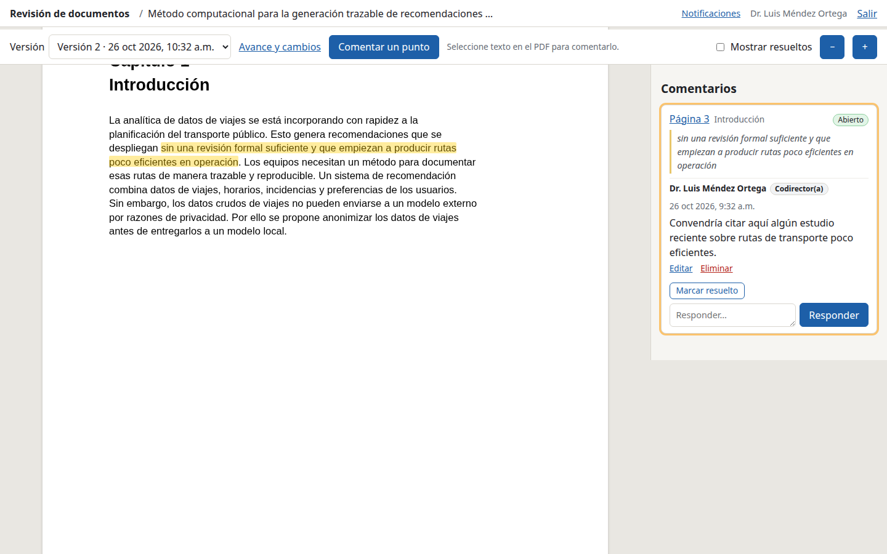

# Guía para revisores

Esta página explica cómo revisar un documento (por ejemplo, una tesis) en el
sitio de revisión. Solo necesita su **enlace personal** y un navegador; también
funciona en el teléfono.

## Entrar

- Abra el **enlace personal** que recibió. Es personal: sus comentarios aparecen
  con su nombre, así que no lo comparta.
- El navegador recuerda su acceso: después puede volver a la dirección del sitio
  sin el enlace. Si cambia de navegador o de equipo, abra el enlace otra vez.
- Si le invitaron a varios documentos, la página de inicio los muestra todos, con
  su rol en cada uno.

## Comentar

- **Un texto**: selecciónelo con el ratón (o con el dedo, en el teléfono) y
  pulse **«Comentar selección»**. Escriba el comentario y pulse **«Publicar
  comentario»**.
- **Un lugar** (una figura, un espacio en blanco): pulse **«Comentar un punto»**
  y haga clic en el lugar de la página.
- El texto admite `**negritas**`, `*cursivas*` y enlaces.

## Hilos

- Los comentarios aparecen a la derecha, en hilos. Puede **responder** en
  cualquier hilo, **editar** o **eliminar** sus propios comentarios, **marcar
  resueltos** los hilos que usted abrió y **reabrir** cualquier hilo.
- «Mostrar resueltos» muestra también los hilos cerrados.
- Según cómo esté configurado el documento, verá los comentarios de los demás
  revisores o solo los suyos y los del autor.

## Versiones

- Arriba puede cambiar de **versión**. Los comentarios se quedan en la versión en
  la que se hicieron.
- **«Avance y cambios»** muestra el avance por sección y qué cambió respecto a la
  versión anterior, oración por oración.

## Notificaciones

En **«Notificaciones»** (arriba) puede elegir:

- recibir un correo cuando alguien responda en un hilo que usted abrió o en el
  que respondió: **al momento**, un **resumen diario** o **nunca**;
- recibir un correo cuando se publique una versión nueva.

Los correos traen un enlace al hilo, nunca su enlace personal: si el sitio le
pide entrar, use su enlace personal. Para recibir correos, el autor debe tener
registrada su dirección.

Gracias por su revisión.
