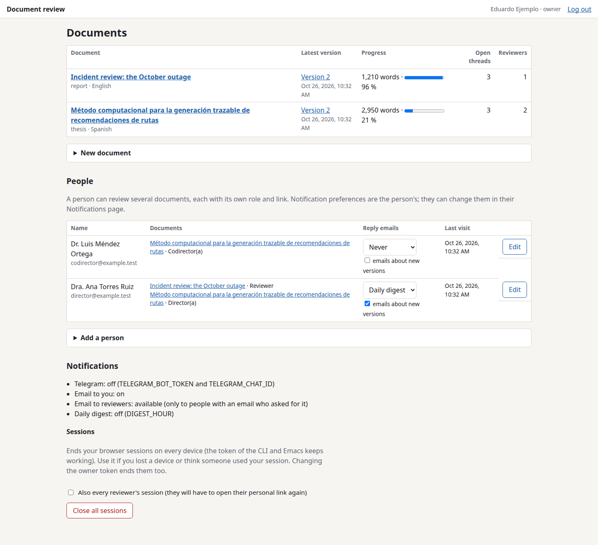
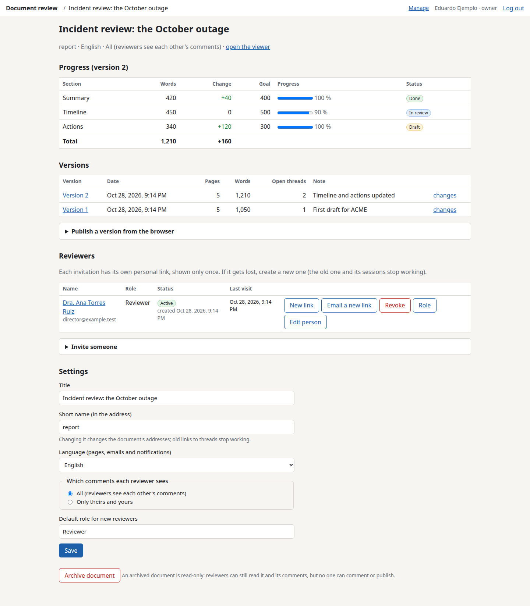
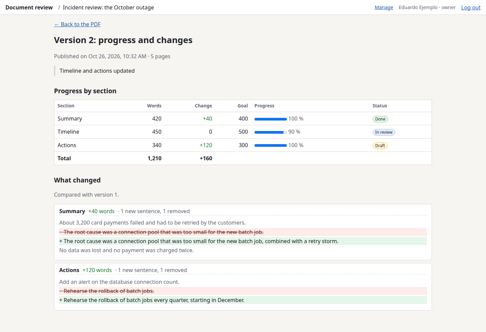
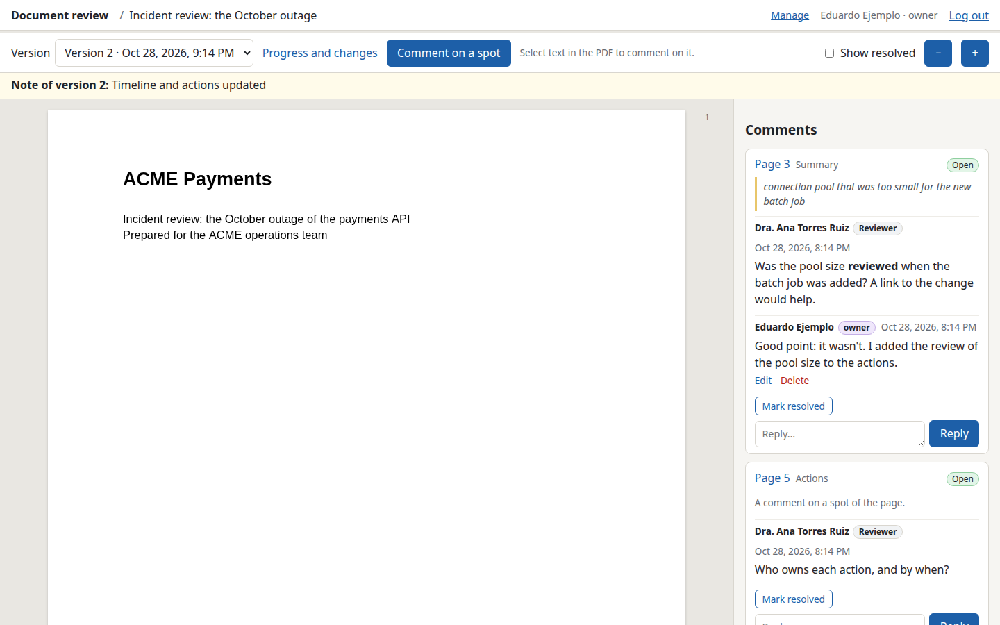
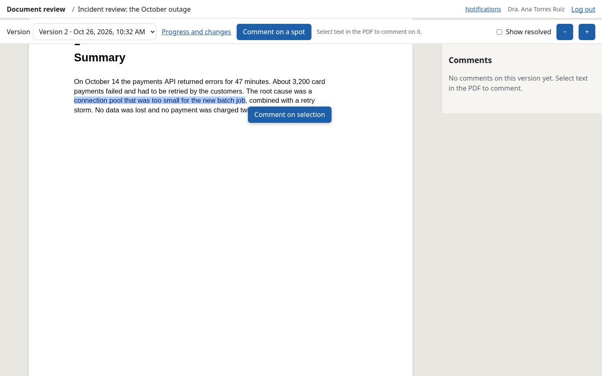

# Using doc-review

- [For you (the owner)](#for-you-the-owner)
  - [First setup](#first-setup)
  - [Documents](#documents)
  - [Publishing a version](#publishing-a-version)
  - [Inviting reviewers](#inviting-reviewers)
  - [People](#people)
  - [Reading and answering comments](#reading-and-answering-comments)
  - [Notifications: Telegram and email](#notifications-telegram-and-email)
- [For reviewers](#for-reviewers) (and a text to send them)



## For you (the owner)

### First setup

1. Generate your owner token:

   ```sh
   doc-review gen-token
   ```

   The first value is the **token** (yours, secret); the second is its
   **SHA-256**, the only thing the server knows (`OWNER_TOKEN_SHA256`; in the
   cluster it goes in the Secret, see [deploy.md](deploy.md)).

2. Save the server's address and the token, readable only by you:

   ```sh
   mkdir -p ~/.config/doc-review
   cat > ~/.config/doc-review/config.json <<'JSON'
   {"url": "https://review.example.com", "token": "dr_owner_…"}
   JSON
   chmod 600 ~/.config/doc-review/config.json
   ```

   The CLI and Emacs refuse the file if others can read it, and refuse addresses
   that don't start with `https://` (`http://` only for `localhost`). Tokens of
   other servers go under `"servers": {"https://other.example": "dr_owner_…"}`.

3. In the browser, sign in once at `https://review.example.com/login` with the
   token: the browser keeps a 30-day session (renewed while you use it).

   - **Changing the token** (`gen-token` again and the new SHA-256 in the
     Secret) ends every browser session opened with the old one.
   - **Close all sessions** (dashboard → Sessions, or `doc-review sessions
     close-all`) ends your browser sessions everywhere (the CLI and Emacs keep
     working); with «Also every reviewer's session» (`--reviewers`) reviewers have
     to open their personal link again.

The dashboard and the pages outside a document follow your browser's language
(English or Spanish).

### Documents

Each document has a **short name** (its address: `/d/thesis`), a **title**, a
**language** (its pages for reviewers, its emails and Telegram messages), a
**visibility** mode and a **default role** for new reviewers.

- **Create**: on the dashboard, «New document», or

  ```sh
  doc-review documents create thesis "Método computacional para la generación trazable de recomendaciones de rutas" \
    --language es --default-role "Director(a)"
  doc-review documents create acme-q3 "Incident review: the October outage" --language en --default-role Client
  ```

- **Rename / settings**: the document's page («Manage» in the top bar), or
  `doc-review documents rename SLUG "New title" [--slug new-slug]` and
  `doc-review documents set SLUG --language en|es --visibility all|own
  --default-role ROLE`. Changing the short name changes the addresses: old
  links to threads stop working (personal links keep working).
- **Visibility**: «All» (reviewers see each other's comments; good for a thesis
  committee that discusses) or «Only theirs and yours» (each reviewer sees only
  their threads and yours, and in them only your messages and theirs; good for
  clients that shouldn't see each other). It applies to notifications too.
- **Archive**: the document becomes read-only (reviewers can still read it and
  its comments); `doc-review documents archive SLUG` / `unarchive`.
- `doc-review documents list` shows every document with its latest version,
  open threads and reviewers.



### Publishing a version

Build your PDF as usual and publish it, optionally with a `progress.json` and a
note. Each publication is a **new version**; comments stay on the version they
were made on, and each version shows its **progress and changes**.

- **CLI**, with the files:

  ```sh
  doc-review publish -d thesis tesis.pdf avance.json -m "Addressed the comments on chapter 2"
  ```

- **CLI or Emacs from a project**: put a `.doc-review.json` at the root of the
  project (see [emacs.md](emacs.md#the-project-file-doc-reviewjson)) and run
  `doc-review publish -m "…"` anywhere under it, or `M-x doc-review-publish`.
  For the thesis template:

  ```json
  {"document": "thesis", "pdf": "tesis.pdf",
   "progress": {"command": "make avance", "file": "avance.json"},
   "sources": ["tesis.org", "capitulos/*.org"]}
  ```

- **Web**: the document's page, «Publish a version from the browser».

The server checks that the file is a valid PDF (at most 50 MB) and that the
progress file is well-formed. Reviewers who asked for it get an email about the
new version with your note (never with their personal link).

**progress.json** is optional:

```json
{"schema": 1, "title": "…", "generated_at": "2026-10-24T18:00:00Z", "total_words": 2950,
 "sections": [{"id": "01-introduction", "title": "Introduction", "words": 1450,
               "goal": 3000, "status": "review"}]}
```

`status` is `draft`, `review`, `done` or `null`; `goal` is a word goal or
`null`. The thesis template's `avance.json` (`chapters`, statuses `borrador`,
`revision`, `terminado`) is accepted as it is. `doc-review progress root.org -o
progress.json` builds one from the `#+INCLUDE:` files of an org document (goal
and status from `#+PROGRESS_GOAL:` / `#+PROGRESS_STATUS:`, or the template's
`#+AVANCE_META:` / `#+AVANCE_ESTADO:`).

On the web, «Progress and changes» shows the table per section (words, change
since the previous version, goal, status) and what changed in the text, sentence
by sentence, per section. Sections are located in the PDF by their titles; if
they can't be (or there's no progress file), the whole document is compared.



### Inviting reviewers

A **person** (name, optional email) is invited to a **document** with a **role**
(free text; the form suggests Director, Co-director, Reviewer, Client,
Co-author in the document's language). Each invitation has its own **personal
link**, shown **only once**; the server keeps only a hash.

- **Invite**: the document's page, «Invite someone» (an existing person, or
  someone new), or

  ```sh
  doc-review invite -d thesis "Dra. Ana Torres Ruiz" --email ana@… --role "Director(a)"
  doc-review people list                                     # the ids
  doc-review invite -d acme-q3 --person 1 --role Reviewer    # the same person, another document
  ```

  «Send the link by email» (`--send-link`) sends it in that email only, and only
  if you ask; otherwise copy it and send it yourself through a private channel.
- **New link** (rotate): another link; the old one and the sessions opened with
  it stop working. Use it if a link was lost or shared too widely.
  `doc-review invitations rotate ID [--send-link]`.
- **Revoke**: ends the access to that document at once.
  `doc-review invitations revoke ID`. «Reactivate with a new link» enables it
  again with a different link.
- **Email a new link**: for someone with an email address, «Email a new link»
  creates a new link and sends it to them (after a confirmation that names the
  address; the old link stops working). Only the hash of a link is stored, so
  the current one can't be re-sent. Nothing changes if the person has no address
  or the server has no SMTP. `doc-review invitations rotate ID --send-link`.
- **Role**: the «Role» button or `doc-review invitations role ID "Co-director"`.
- **State**: each invitation shows «Active» (the link was opened), «Not opened
  yet» or «Revoked», with the dates it was created, given a new link and
  revoked.
- `doc-review invitations list -d SLUG` shows the ids.

### People

Each person has a page (click their name on the dashboard or in a document's
reviewers, or «Edit person»), with:

- **Name, email and notifications**: add, change or remove (leave it empty) the
  email address, and set the reply emails (at once, daily digest, never) and the
  emails about new versions. From a shell:
  `doc-review people set ID --email ana@example.org`, `--email ""` to remove
  it, `--name "…"`, `--replies daily`, `--versions` / `--no-versions`.
- **Their invitations** to every document, with the same state and actions as
  on the document's page.
- **Delete**: only for someone who never commented (for example, invited by
  mistake); their invitations go too. `doc-review people remove ID`.
- **Archive**: for someone who commented and no longer reviews. Every invitation
  is revoked at once (links and sessions stop working), they disappear from the
  dashboard's list and the documents' reviewers, and their comments stay.
  Archived people are listed apart on the dashboard («N archived people») and
  can't be invited or get a new link until they are **unarchived**; unarchiving
  doesn't reactivate any invitation (reactivate each one with a new link).
  `doc-review people archive ID` / `unarchive ID`;
  `doc-review people list --archived` lists them too.

When a reviewer opens a link, their browser keeps a session (180 days, renewed
while used) and the address changes to the document, so the secret doesn't stay
in the history. One session holds all of that person's documents: opening any of
their links lists every document they were invited to. If the browser had
someone else's session (yours, if you try a link yourself), it asks «Sign in as
…?» first.

**Notification preferences** are the person's (their page, the dashboard's
People section, `doc-review people set ID --replies instant|daily|never --versions`, or the
reviewer's own «Notifications» page):

- when someone else replies in a thread they opened or replied to: an email **at
  once**, a **daily digest** (per document, in its language) or **never** (the
  default);
- an email when a new version of one of their documents is published.

Emails link to the thread, never to the personal link, and respect each
document's visibility.

Each reviewer can write up to 500 comments and replies in 24 hours
(`MAX_REVIEWER_COMMENTS_PER_DAY`), besides the limit of 60 per minute.

### Reading and answering comments

- **Web**: in each version, the right column lists the threads; «Show resolved»
  also shows the closed ones. You can reply, resolve or reopen, and edit or
  delete your own messages.
- **Who resolves**: only whoever opened a thread, and you (always, also from Emacs
  and the CLI). Anyone who sees a thread can reopen it.
- **Telegram / email**: a message for each comment or reply of a reviewer, with
  the quote and the link to the thread (in the document's language); or a daily
  digest per document. If a reviewer **edits** a comment you get the previous and
  the new text (the server keeps the last 20: `GET /api/comments/ID/edits`).
- **CLI**: `doc-review comments` (open threads of the project's document), `-d
  SLUG`, `--all`, `--version N`, `--json`.
- **Emacs**: `M-x doc-review-comments` opens an org buffer grouped by section and
  page, linked to the place in your sources; reply, resolve and see the comments
  as Flymake notes. See [emacs.md](emacs.md).



### Notifications: Telegram and email

Each channel is turned on separately (see the configuration table in the
README). The startup log line says which ones are on.

#### Telegram

1. Talk to [@BotFather](https://t.me/BotFather), `/newbot`, choose a name: it
   gives you `TELEGRAM_BOT_TOKEN`.
2. Write anything to your bot, then get your chat id from
   `curl https://api.telegram.org/bot<TOKEN>/getUpdates` (`"chat":{"id":…}`):
   that is `TELEGRAM_CHAT_ID`.
3. Put both in the server's Secret. Messages are plain text with the link to the
   thread; they never carry secrets.

#### Email (Proton Mail)

Proton's SMTP submission needs a paid plan and works only for **custom-domain
addresses**.

1. In Proton: Settings → All settings → IMAP/SMTP → SMTP tokens → Generate
   token; choose the address and copy the token (shown once).
2. Configure the server:

   | Setting | Value |
   |---|---|
   | `SMTP_HOST` | `smtp.protonmail.ch` |
   | `SMTP_PORT` | `587` |
   | `SMTP_SECURITY` | `starttls` |
   | `SMTP_USER` | that address |
   | `SMTP_PASSWORD` | the token (in the Secret; your account password never works) |
   | `SMTP_FROM` | that address, or `"Document review <review@your-domain>"` |
   | `EMAIL_OWNER_TO` | where you want your notifications |

   Proton Bridge is not suitable for a server (it's a desktop app holding the
   mailbox keys).

#### Digests

- `DIGEST_HOUR=8` sends you, at 8:00 (`TZ`), one digest per document with the
  reviewers' comments of the last 24 hours, on every channel that's on. With
  `NOTIFY_INSTANT=false` you get only the digests. If every channel fails, it
  tries again every 5 minutes that day.
- Reviewers' daily digests go at the same hour (8:00 if `DIGEST_HOUR` is unset),
  one per document, in the document's language.

## For reviewers

Reviewers need nothing but their personal link and a browser (phones work too).

- **Comment on text**: select it in the PDF and click «Comment on selection».
- **Comment on a spot** (a figure, a gap): «Comment on a spot», then click the
  place on the page.
- Threads appear on the right: reply and reopen any thread, mark resolved the
  threads they opened, edit or delete their own comments. Text supports
  `**bold**`, `*italic*`, `` `code` `` and links.
- At the top: the version selector and «Progress and changes».
- «Notifications» (top bar): emails when someone replies in their threads (at
  once, daily or never) and when a version is published.
- With several documents, the start page lists them, with their role in each.



Spanish-speaking reviewers have a short guide in Spanish:
[reviewers.es.md](reviewers.es.md).

*A text to send with the link:*

> Dear …,
>
> To review the document, open your **personal link** (please don't share it:
> your comments appear with your name). The browser remembers your access; later
> you can go back to the site's address without the link.
>
> - **To comment on text**, select it in the PDF and click «Comment on
>   selection»; to comment on a spot, click «Comment on a spot» and then the
>   place on the page.
> - Comments appear on the right: you can reply, mark your threads resolved, and
>   edit or delete your own comments.
> - «Progress and changes» shows what changed since the previous version.
> - In «Notifications» you can choose to get an email when someone replies to
>   you and when a new version is published.
>
> Thank you for your review.
